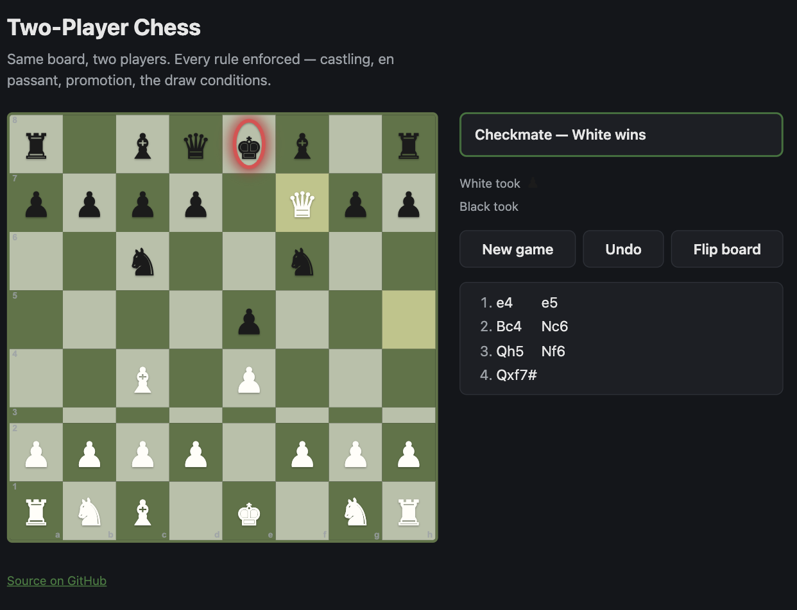

# Two-Player Chess

[](https://github.com/pastbologanesh0101/chess-two-player/actions/workflows/ci.yml)
[](https://github.com/pastbologanesh0101/chess-two-player/actions/workflows/deploy.yml)
[](./LICENSE)

A local two-player chess game in **vanilla JavaScript** — no framework, no chess
library. Both players share the board; the game enforces every rule and calls the
result.

**▶ Play it: https://pastbologanesh0101.github.io/chess-two-player/**



## Features

- **Full legal move generation** — pins, castling (with all its restrictions),
  en passant, and under-promotion to any piece.
- **Every ending detected** — checkmate, stalemate, the fifty-move rule,
  threefold repetition, and insufficient material.
- Move list in **standard algebraic notation** (`Nbd7`, `exd6`, `O-O-O`, `Qxf7#`),
  with disambiguation.
- Click a piece to see its legal moves; last move and a king in check are
  highlighted. Undo, flip board, captured-piece tray.
- Keyboard: <kbd>f</kbd> flip, <kbd>u</kbd> undo, <kbd>n</kbd> new game.
- Loads in ~15&nbsp;kB gzipped. No tracking, no network calls, works offline.

## The engine is verified with perft

[Perft](https://www.chessprogramming.org/Perft) counts the leaf nodes of the move
tree to a fixed depth. Matching the published counts exactly is the standard proof
that move generation has no gaps or leaks. `test/engine.test.js` checks six
positions against the reference numbers and cross-checks them against
[`python-chess`](https://python-chess.readthedocs.io/):

| Position | Depth | Nodes | |
| --- | --- | --- | --- |
| Start | 4 | 197,281 | ✅ |
| [Kiwipete](https://www.chessprogramming.org/Perft_Results#Position_2) | 3 | 97,862 | ✅ |
| Endgame (position 3) | 4 | 43,238 | ✅ |
| Promotions (position 4) | 3 | 9,467 | ✅ |
| Position 5 | 3 | 62,379 | ✅ |
| Position 6 | 3 | 89,890 | ✅ |

## Run locally

Requires Node.js 18+.

```bash
git clone https://github.com/pastbologanesh0101/chess-two-player.git
cd chess-two-player
npm install
npm run dev      # http://localhost:5173
```

```bash
npm test         # engine test suite (vitest)
npm run build    # static bundle -> dist/
```

## Project layout

```
src/
  engine.js   Pure chess logic — no DOM. FEN, move gen, SAN, perft, game status.
  main.js     The UI: board rendering, click handling, move list, controls.
  style.css   Board + panel styling, light/dark aware.
test/
  engine.test.js   Perft, FEN round-trips, castling/en-passant/promotion, SAN, endings.
```

`engine.js` has no dependencies and no side effects, so it can be dropped into any
project or a Node REPL:

```js
import { newGame, legalMoves, makeMove, moveToSAN } from "./src/engine.js";

let game = newGame();
const e4 = legalMoves(game).find((m) => moveToSAN(game, m) === "e4");
game = makeMove(game, e4);
```

## How it works

The board is a 64-element array indexed `rank * 8 + file`. Move generation is
pseudo-legal first — every geometric move for the side to move — then each
candidate is played on a copy and rejected if it leaves the mover's king attacked.
`isSquareAttacked` runs the same scans in reverse from the target square, and is
reused for "is this side in check" and for the three squares a king passes through
when castling. Every `makeMove` returns a fresh state object, which makes undo just
a matter of popping a history stack.

## License

MIT © pastbologanesh0101
